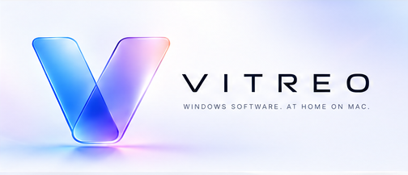

<p align="center">
  
</p>

**Vitreo** is a Windows runtime engine for macOS ARM64. It runs Windows x86 and x86-64 PE executables on Apple Silicon through CPU emulation, Windows API implementation, and graphics translation.

The product site is [vitreo.dev](https://vitreo.dev/). To beta test and help with compatibility, use [beta.vitreo.dev](https://beta.vitreo.dev/).

---

## Help with compatibility testing


Beta test Vitreo at [beta.vitreo.dev](https://beta.vitreo.dev/). Request a build, run a Windows application, and report what happened. That is how compatibility work gets real results. A beta build does not mean any particular application is supported.

1. **Create an account.** Email, a password, and the beta terms.
2. **Request access.** The Mac you will use, and the Windows software you want to try.
3. **Download a build.** Once a build is available, you can download it and check its checksum before opening it.
4. **Post a result.** Name the application (one already reported, or a new one), the build you used, and whether it launched, partly worked, or failed.

Questions can go to [info@vitreo.dev](mailto:info@vitreo.dev).

---

## Project Components

| Component | Description |
|-----------|-------------|
| **CPU Engine** | Interpreter and JIT compiler for x86 (32-bit) and x86-64 (64-bit) instruction sets |
| **PE Loader** | Loads and relocates 32-bit and 64-bit Portable Executable files |
| **Capsule FS** | Isolated virtual filesystem providing Windows-compatible paths and semantics |
| **Windows API** | Thunk-based implementation of Windows DLLs via IAT patching |
| **Windowing** | Maps Windows controls and messages to macOS Cocoa |
| **Graphics** | DirectX 9/11/12 and Vulkan translated directly to Metal |
| **vitreo** | Command-line interface for capsule and execution management |

---

## Goals

- Run unmodified Windows executables on macOS ARM64
- Implement sound, observable Windows API / NT / loader / sync / CPU contracts
- Provide sufficient Windows API coverage for common applications and games
- Achieve playable performance through JIT compilation and native Metal rendering
- Isolate guest applications in sandboxed capsules

Compatibility targets (Steam, Spotify, games, …) are **repros**. Product code
fixes Windows contracts; it does not grow app-specific hacks.

---

## Non-Goals

- Full Windows kernel emulation
- Driver support
- 16-bit DOS/Windows 3.x compatibility
- Network stack reimplementation (uses host networking)
- App-specific shims, vendor-DLL stubs, or fake success to “get past” one binary

---

## Architecture

```
┌─────────────────────────────────────────────────────────────┐
│                         vitreo                              │
├─────────────────────────────────────────────────────────────┤
│  Capsule Manager  │  Process Manager  │  Config Manager     │
├───────────────────┴───────────────────┴─────────────────────┤
│                      Vitreo Runtime                         │
├──────────┬──────────┬──────────┬──────────┬─────────────────┤
│ CPU      │ PE       │ Capsule  │ WinAPI   │ Graphics        │
│ Engine   │ Loader   │ FS       │ Thunks   │ (DX→Metal)      │
├──────────┴──────────┴──────────┴──────────┴─────────────────┤
│                    macOS / ARM64 / Metal                    │
└─────────────────────────────────────────────────────────────┘
```

---

## Layout

`vitreo` is the executable, written to `build/src/vitreo`. Direct3D and Vulkan live under `src/winapi/graphics/` and lower to Metal in `src/graphics/`.

```
.
├── CMakeLists.txt          # configure and FetchContent
├── cmake/                  # module helper and architecture checks
├── include/vitreo/         # shared headers
├── src/
│   ├── main.cpp            # process entry
│   ├── app/cli/            # vitreo commands
│   ├── core/               # cpu (interpreter, JIT, decode), pe, memory, sync
│   ├── capsule/            # virtual filesystem, registry, environment
│   ├── winapi/             # kernel32, user32, ntdll, gdi32, d3d, vulkan, crt, …
│   ├── windowing/          # Cocoa window presentation
│   ├── graphics/           # Metal backend, shaders, format conversion
│   ├── runtime/            # guest process and execution
│   ├── platform/           # macOS host services
│   ├── audio/
│   ├── ipc/
│   └── hardware/
├── tests/                  # CTest suites, on by default
├── third_party/notices/    # license texts copied next to vitreo
├── assets/                 # icons from vitreo.dev and beta.vitreo.dev
└── manager/                # Vitreo.app (Swift). Requires macOS 14
```

---

## Requirements

- Apple Silicon Mac. The engine deployment target is macOS 13.0. `manager/` requires macOS 14.
- Xcode or the Xcode Command Line Tools: a C++20 compiler and the macOS SDK (Metal is a system framework).
- CMake 3.25 or newer.
- Git, and network access on the first configure. CMake clones SPIRV-Cross and glslang at `vulkan-sdk-1.3.283.0`. If tests stay enabled, it also downloads GoogleTest 1.14.0.

An `x86_64` configure selects the native guest backend. That backend is in development. The supported host is arm64.

Use an arm64 CMake, for example Homebrew's `/opt/homebrew/bin/cmake`. An x86_64 CMake running under Rosetta configures the Intel backend, which has no JIT. To check yours, run `file "$(command -v cmake)"`.

---

## Build

Engine only. This skips the test suite:

```bash
cmake -B build -DVITREO_BUILD_TESTS=OFF
cmake --build build --target vitreo
```

The binary is `build/src/vitreo`. The build also copies `third_party/notices/runtime/` to `build/src/third-party-notices`. Ship that directory with the executable.

Default configure also builds the tests:

```bash
cmake -B build
cmake --build build
ctest --test-dir build --output-on-failure
```

Add `-G Ninja` to the configure line if Ninja is installed. It is not required.

The macOS app is separate. Build the engine first, then:

```bash
manager/build.sh
```

That writes `manager/build/debug/Vitreo.app` and embeds `build/src/vitreo`.

A disk image for distribution, including the same build GitHub Actions runs:

```bash
manager/package-dmg.sh
```

That configures a Release engine in `build/package` with tests off, builds `Vitreo.app`, and writes `dist/Vitreo-<version>-arm64.dmg` plus a `.sha256` file. The disk window shows Vitreo beside an Applications shortcut, with an arrow between them. The app is ad-hoc signed and not notarized.

On GitHub, run Actions → Release. Leave **publish** off to only produce the DMG artifact. Turn it on, with a version such as `1.0.0`, to open a draft GitHub Release. Publishing that draft is a separate step.

---

## Run

```bash
./build/src/vitreo --help

./build/src/vitreo capsule create my-app
./build/src/vitreo run /path/to/program.exe --capsule my-app
./build/src/vitreo process list --capsule my-app
```

Commands are `run`, `capsule`, `mount`, `unmount`, `process`, `version`, and `help`. `vitreo run` takes the PE path first: `vitreo run <pe-path> [--capsule <name>] [--app-name <name>] [-- <args...>]`.

---

## License

Vitreo is licensed under the GNU Lesser General Public License, version 2.1 only.
The license text is [LICENSE](LICENSE).

The D3D11 fixed-function tessellator in `src/graphics/shaders/tessellator.hpp`
remains under the MIT license stated in that file. Third-party notices for
linked libraries are in `third_party/notices/`.
